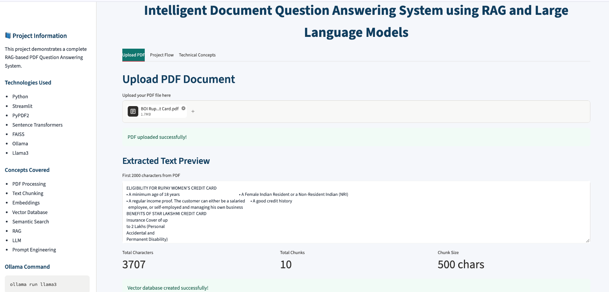
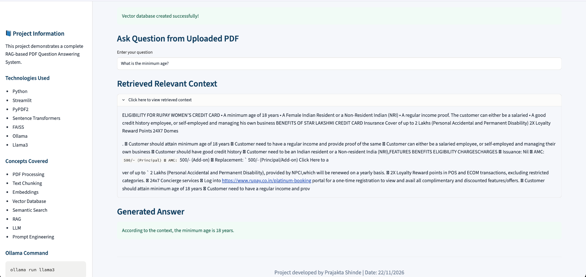
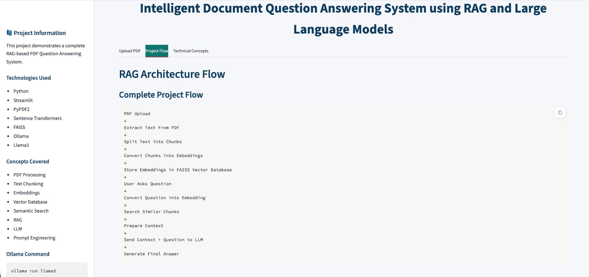
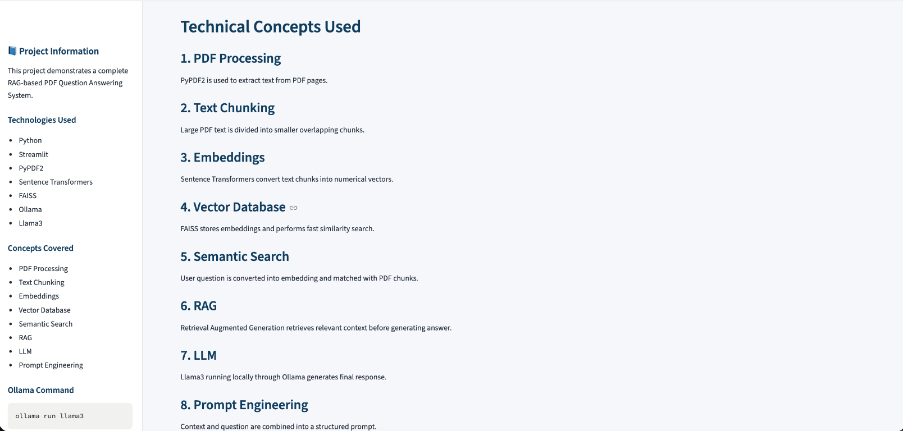

# Intelligent Document Question Answering System

A Streamlit application that lets you upload a PDF and ask questions about its contents. It uses retrieval-augmented generation (RAG): relevant passages are retrieved from the document and sent to a local Llama 3 model through Ollama.

## Features

- Extracts text from uploaded PDF files.
- Splits document text into overlapping chunks (500 characters with 100-character overlap).
- Creates embeddings with Sentence Transformers and indexes them with FAISS.
- Retrieves the three most relevant chunks for a question.
- Generates an answer grounded in the retrieved context using Ollama.
- Includes Project Flow and Technical Concepts pages.

## Screenshots

### PDF upload and indexing



### Retrieved context and generated answer



### Project flow



### Technical concepts



## Requirements

- Python
- [Ollama](https://ollama.com/) with the `llama3` model

The first application launch may download the `all-MiniLM-L6-v2` embedding model.

## Setup and run

1. Clone or download this repository and open a terminal in the project directory.
2. Create and activate a virtual environment:

   **macOS/Linux**

   ```bash
   python3 -m venv .venv
   source .venv/bin/activate
   ```

   **Windows PowerShell**

   ```powershell
   py -m venv .venv
   .venv\Scripts\Activate.ps1
   ```

3. Install the project dependencies:

   ```bash
   python -m pip install -r requirements.txt
   ```

4. Start Ollama and download/run the model:

   ```bash
   ollama run llama3
   ```

   Keep the Ollama service running. The app sends requests to `http://localhost:11434`.

5. In another terminal, activate the virtual environment if needed, then start Streamlit:

   ```bash
   streamlit run main.py
   ```

   Open the local URL printed by Streamlit (usually `http://localhost:8501`).

## Using the application

1. Open the **Upload PDF** tab and upload a text-based PDF.
2. Wait for text extraction, chunking, and vector indexing to finish.
3. Enter a question about the document. The retrieved context and generated answer will appear below.
4. Use **Project Flow** to view the processing steps, or **Technical Concepts** for brief explanations of the technologies.

Scanned/image-only PDFs may not contain extractable text and may need OCR before uploading.

## Troubleshooting

- **Ollama connection error:** Confirm Ollama is running and that `http://localhost:11434/api/tags` responds. The application uses Ollama's local HTTP API.
- **Model not found:** Run `ollama run llama3` in a terminal to download the model and start a session, then retry the question.
- **No readable PDF text:** Use a PDF with selectable text or run OCR on the document first.

## Technology stack

Python, Streamlit, PyPDF2, Sentence Transformers, FAISS, and Ollama (Llama 3).
